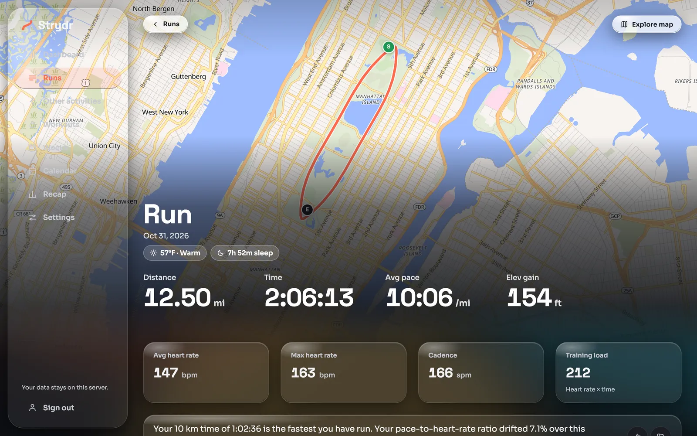
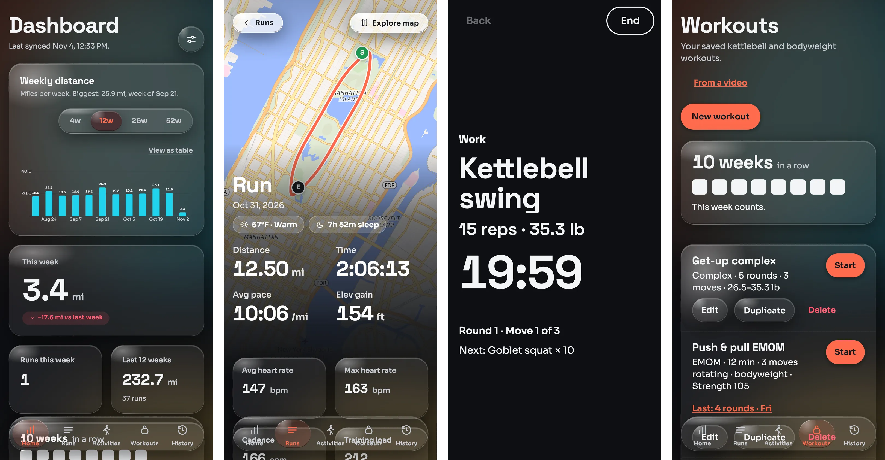
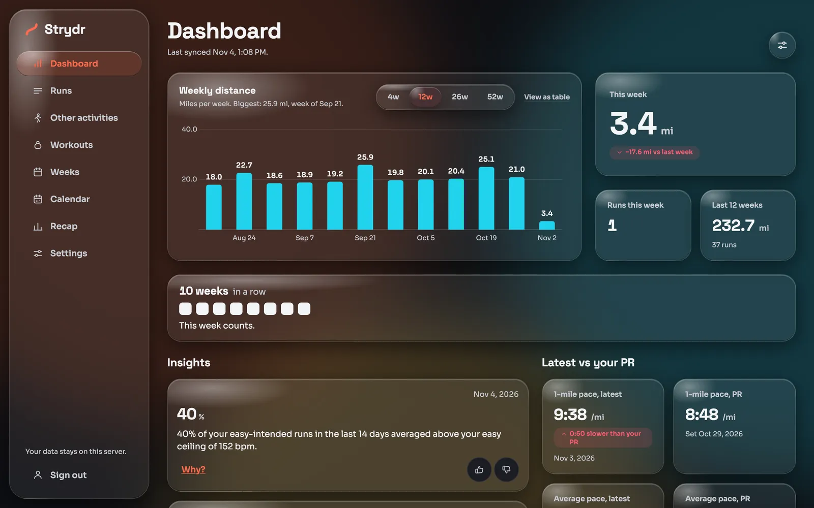
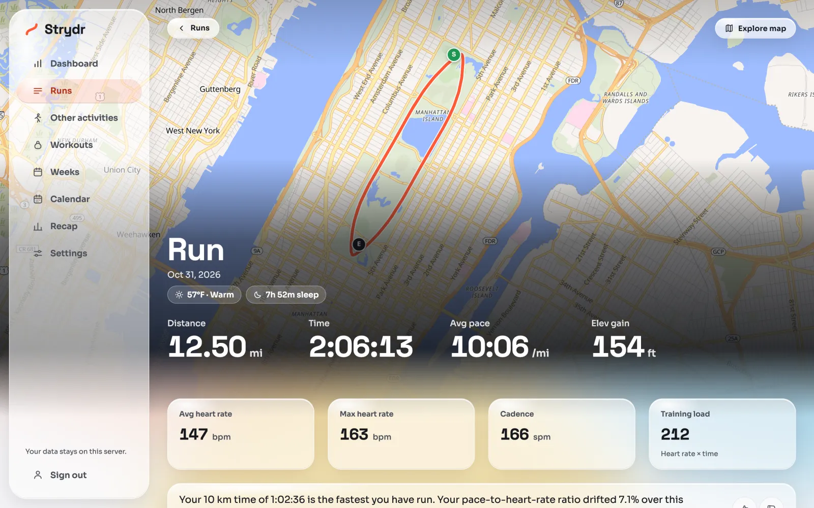
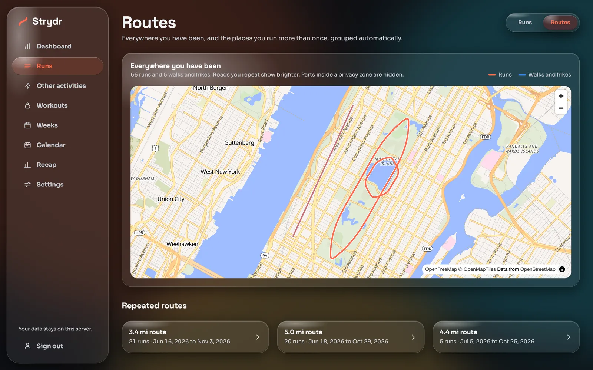
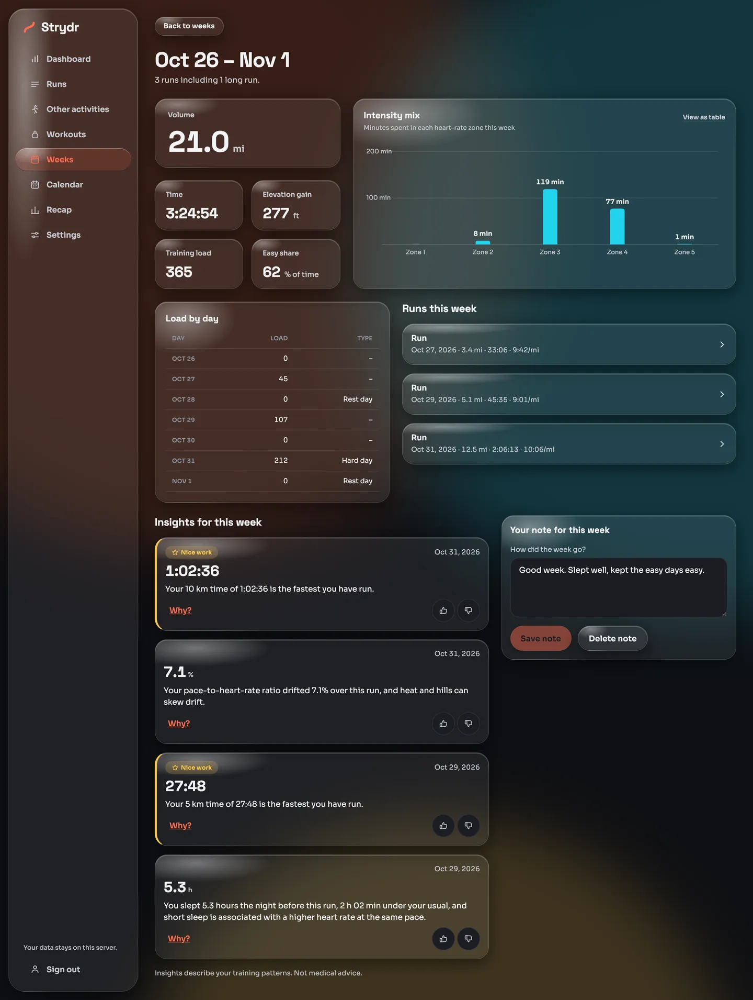
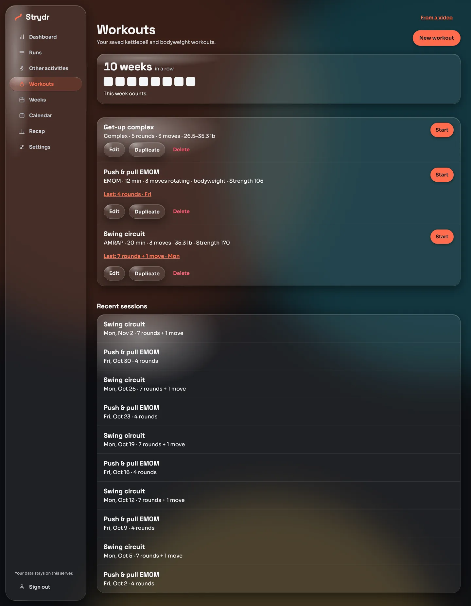
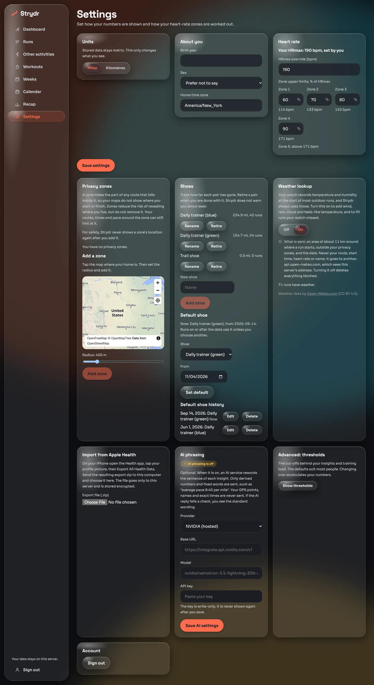
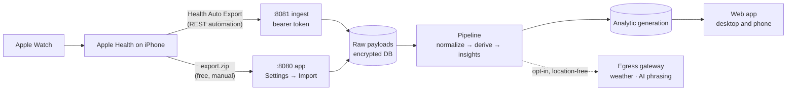

  <picture>
    <source media="(prefers-color-scheme: dark)" srcset="web/public/brand/strydr-lockup-dark.svg">
    
  </picture>

  <strong>Self-hosted running analytics and home-workout tracking for Apple Watch users.</strong> 
  Each run explained in context: heat, hills, sleep, resting heart rate, HRV and the week around it. 
  Everything stays in one encrypted database on your own machine.

  
  
  
  
  
  
  

  <a href="docs/getting-started.md">Get started</a> ·
  <a href="docs/features.md">Features</a> ·
  <a href="docs/importing-data.md">Import data</a> ·
  <a href="docs/privacy-and-security.md">Privacy</a> ·
  <a href="docs/README.md">All docs</a>

  

> All screenshots use a made-up runner in Central Park, generated from synthetic data. No real person's data appears anywhere in this repository.

> **Built with AI.** Nearly all of Strydr's code, tests and documentation were written by AI coding tools, not by hand.
> It is one person's hobby project, made for their own training. See [About this project](#about-this-project).

## Why Strydr

Your Apple Watch records a lot, and most apps only show you the numbers. Strydr asks what they mean: *was that run slow because of the heat, the hill, a short night's sleep, or a heavy week?* It answers with plain-language insights built from your own history, and keeps all of it on a computer you own.

- **Your data, your disk.** One SQLCipher-encrypted database, nightly encrypted snapshots, no account, no cloud, no telemetry.
- **Context, not just charts.** Weather, terrain, sleep, resting heart rate, HRV and training load are linked to each run.
- **Honest numbers.** Heart rate is kept at full resolution, pauses are removed, impossible samples are dropped and counted, and estimates are labelled as estimates.
- **Runs and home strength in one place.** Kettlebell and bodyweight workouts get a live phone timer, a summary with your watch's heart rate, and progress over time.
- **AI is optional.** Insights are rule-based. If you want, an AI model can reword them, and only location-free derived numbers are ever sent.

## Features at a glance

| | |
|---|---|
|  | **[Dashboard](docs/features.md#dashboard)** Weekly distance, this week against last, your streak, latest pace against your personal records, and an insight feed with a "Why?" for every fact. |
|  | **[Run detail](docs/features.md#run-detail)** Map, splits with grade-adjusted pace, pace, heart-rate and elevation charts, conditions, sleep the night before, run/walk split, shoes, carried weight and your own note. |
|  | **[Routes](docs/features.md#routes)** A map of everywhere you have been, and repeated routes found automatically, with section-by-section comparison against your usual. |
|  | **[Weeks, calendar and recap](docs/features.md#weeks)** Fitness, fatigue and form; training state; intensity mix; load by day; hard and rest days; monthly and yearly recaps. |
|  | **[Home workouts](docs/home-workouts.md)** AMRAP, EMOM and complex workouts with a live full-screen timer, watch heart rate per move, strength score, bodyweight levels and import from a YouTube Short. |
|  | **[Settings](docs/features.md#settings)** Units, heart-rate zones, privacy zones, shoes, weather lookup, Apple Health import, optional AI and advanced thresholds. |

See the **[full feature tour](docs/features.md)** for every page.

## How it works

1. Your watch writes workouts and health metrics to Apple Health.
2. [Health Auto Export](docs/importing-data.md#health-auto-export) pushes them to Strydr's ingest port on a schedule, or you upload Apple's own `export.zip` for free.
3. Strydr stores the raw payload, normalizes it, and recomputes everything: summaries, load, records, routes and insights.
4. You browse the results in the web app on your computer or phone, on your home network or over Tailscale.

More in [Architecture](docs/architecture.md).

## Quick start

Pick the install that suits you. Each takes you to a running server with a sign-in and an ingest token.

| You have | Do this | Guide |
|---|---|---|
| A Windows 10/11 PC | Double-click one installer. It sets up WSL 2, Docker and Strydr. | [Windows](install/windows/README.md) |
| A Linux server or NAS (x86_64 or arm64) | Create a key in `secrets/`, then `docker compose build`, `docker compose run --rm strydr init`, `docker compose up -d strydr` | [Docker](docs/installation.md#docker-linux) |
| A Mac, for development | `uv sync`, `strydr init`, `strydr serve`, then `npm run dev` | [Development](docs/development.md) |

Then [connect your iPhone](docs/importing-data.md) and open `http://<server>:8080`.

## Documentation

| Topic | |
|---|---|
| [Getting started](docs/getting-started.md) | From nothing to your first synced run |
| [Installation](docs/installation.md) | Docker, Windows, Cloudflare tunnel, Tailscale, upgrades, backups |
| [Importing data](docs/importing-data.md) | Health Auto Export, Apple Health export, backfill, re-sends, fixing types |
| [Feature tour](docs/features.md) | Every page, with screenshots |
| [Home workouts](docs/home-workouts.md) | Plans, the live screen, summaries, strength score, levels, YouTube import |
| [Insights reference](docs/insights.md) | Every insight rule and when it fires |
| [Training load and metrics](docs/metrics.md) | How load, fitness, form, zones, records and adjusted pace are worked out |
| [Privacy and security](docs/privacy-and-security.md) | Encryption, ports, privacy zones, what leaves the server |
| [Configuration](docs/configuration.md) | Environment variables, CLI, thresholds, route tuning |
| [Architecture](docs/architecture.md) | Components, pipeline, jobs, data model |
| [Development](docs/development.md) | Local setup, tests, fixtures, project layout |
| [Troubleshooting and FAQ](docs/troubleshooting.md) | Common problems and answers |

## Tech stack

**Backend:** Python 3.14, FastAPI, SQLAlchemy and Alembic, SQLCipher, NumPy and Shapely, managed with uv.
**Frontend:** Vue 3, TypeScript, Vite, Pinia, MapLibre GL with OpenFreeMap tiles.
**Runs on:** Docker (x86_64 and arm64), Windows via WSL 2, or bare macOS/Linux.

## About this project

Strydr started as a personal experiment. I'm a developer, but I'm also a busy dad with a full-time job, and I wanted
to see how far I could get by "vibe coding" a self-hosted app to help with my own runs and home workouts.

To be clear about who did what:

- **AI wrote it.** Nearly all of the code, tests and documentation in this repository were written by AI coding tools.
  I did not write it by hand, and I don't want to take credit as if I had.
- **My part** was the idea, deciding what it should do and how it should feel, checking the results, and using it every
  day on my own training to see what broke.
- **It is built for one person.** It fits my watch, my runs and my workouts. It works for me, but expect rough edges.
- **Review it like any code you didn't write.** Read it before you trust it with your health data, and keep the
  database key and backups somewhere safe.

Issues and pull requests are welcome, but this is a hobby project, so replies may be slow.

## Contributing

Issues and pull requests are welcome. Read [Development](docs/development.md) for setup, tests and conventions. Tests run only on synthetic fixtures; never add real health data to the repository.

## Disclaimer

Strydr describes training patterns. It is not medical advice. Apple Watch heart-rate and HRV readings are noisy, and Strydr's wording says so.

## License

[MIT](LICENSE)
