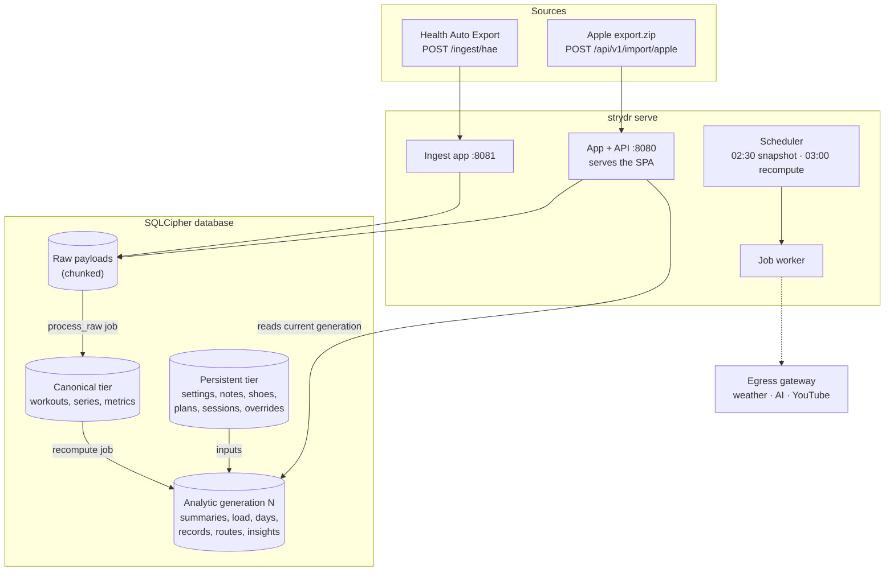

# Architecture

Strydr is one Python process serving two ports, one background worker, one encrypted SQLite database, and a Vue
single-page app. There is no external database, queue or cache to run.



## Data flow

1. **Ingest.** A request is authenticated and streamed into the database in chunks as a raw payload. The
   ingest app answers `202 Accepted` right away and enqueues a `process_raw` job. Identical bodies are recognised and
   ignored.
2. **Normalize.** A source adapter (`sources/hae`, `sources/apple`) is the only code that knows a source's format. It
   stream-parses the payload into canonical models: workouts, sample series (heart rate, route, steps, splits), daily
   metrics and sleep nights. Writes follow a precedence rule, so a richer copy of a workout wins and a full tie keeps the
   existing one. Each adapter has an `ADAPTER_VERSION`; when it goes up, a `reparse` job rebuilds the canonical tier from
   the stored raw payloads.
3. **Recompute.** The `recompute` job builds a complete new **analytic generation** from the canonical and persistent
   tiers: the profile (HRmax, zones, baselines), run summaries, grade and conditions, load, days, records, routes and
   insights. When it is done, one pointer flips to the new generation and the old one is deleted. Readers never see a
   half-built state.
4. **Phrase and fetch.** Optional `phrase` (AI) and `fetch_weather` jobs run only when nothing else is pending. Their
   results are cached by a hash of their inputs, so a stale AI sentence is never shown.
5. **Serve.** The API reads the current generation. Some views (home-workout summaries, progress, streaks) are computed
   on read from the persistent tier.

## Three tiers

| Tier | Holds | Rebuilt? |
|---|---|---|
| **Raw** | Every payload exactly as received | Never; it is the source of truth |
| **Canonical** | Workouts, series, metrics, sleep, as parsed | From raw, by `reparse`, whenever an adapter changes |
| **Persistent** | What you entered: settings, notes, shoes, carries, type and sleep corrections, route overrides, privacy zones, plans, sessions, insight feedback | Never rebuilt; survives reparses |
| **Analytic** | Everything derived | Every recompute, as a new generation |

Because raw payloads are kept, any analysis can be recomputed from scratch, and parsing bugs are fixed by shipping a new
adapter version, not by asking you to re-export.

## Jobs

One worker thread claims jobs from a table in the database, oldest first. Failed jobs are retried with exponential
backoff and then marked failed.

| Job | When |
|---|---|
| `process_raw` | After each ingest |
| `import_apple` | After an `export.zip` upload. Validates the whole file in one pass, then writes in a second |
| `recompute` | After new data or a settings change, and daily at 03:00 home time |
| `reparse` | On start, when a stored adapter version is older than the code's |
| `snapshot` | Nightly at 02:30 home time; keeps 7 |
| `fetch_weather` | With weather lookup on, for outdoor workouts without it |
| `phrase` | With AI on, for insights and run summaries |

## Pure pipeline

Everything under `backend/strydr/pipeline/derive` and `pipeline/insights` is pure: plain values in, plain values out,
no database, clock or network. That keeps the maths testable on synthetic fixtures and deterministic between
recomputes. Tunable numbers live only in [`config/thresholds.toml`](../backend/config/thresholds.toml) and
[`config/routes.toml`](../backend/config/routes.toml).

## Egress gateway

All outbound calls go through `backend/strydr/egress`. Each call has an allow-listed request shape: a weather grid cell
and date, an AI payload of derived numbers and fixed words, or a YouTube video ID. Anything else is rejected before
sending. See [Privacy and security](privacy-and-security.md#what-leaves-the-server).

## Frontend

The web app (`web/`) is Vue 3 with TypeScript, built by Vite and served by the app port as static files (any non-`/api`
path falls back to `index.html`). State is in Pinia stores; API types are generated from `backend/openapi.json`. Maps use
MapLibre GL. The live workout screen runs its timer from a pure engine (`web/src/lib/workoutEngine.ts`) that replays an
event log, which is also what gets saved, so the summary can be rebuilt exactly. The visual design system is in
[`design-system/`](../design-system/README.md).

## Repository layout

```
backend/
  strydr/
    api/          app-port routers (FastAPI)
    ingest/       ingest-port app
    auth/         passwords, sessions, ingest tokens
    sources/      hae/ and apple/ adapters → canonical models
    pipeline/     normalize/, derive/, insights/, phrasing/, profile/
    jobs/         queue, worker, scheduler, recompute, reparse, snapshot, weather
    egress/       outbound calls: weather, AI providers, YouTube
    store/        models, migrations (Alembic), generations, settings
  config/         thresholds.toml, routes.toml
  tests/          pytest, synthetic fixtures only
web/              Vue 3 SPA
fixtures/         generators for synthetic HAE and Apple exports
deploy/           Docker deployment guide
install/windows/  one-step Windows installer
design-system/    tokens, components and brand assets
```
