# Feature tour

A walk through every page in Strydr. The app works the same on a desktop browser and a phone; on a phone, the sidebar
becomes a bottom tab bar and Weeks, Calendar and Recap are grouped under **History**.

- [Dashboard](#dashboard)
- [Runs](#runs)
- [Run detail](#run-detail)
- [Other activities](#other-activities)
- [Routes](#routes)
- [Weeks](#weeks)
- [Calendar](#calendar)
- [Recap](#recap)
- [Workouts](#workouts)
- [Settings](#settings)
- [Light and dark](#light-and-dark)
- [On your phone](#on-your-phone)

---

## Dashboard

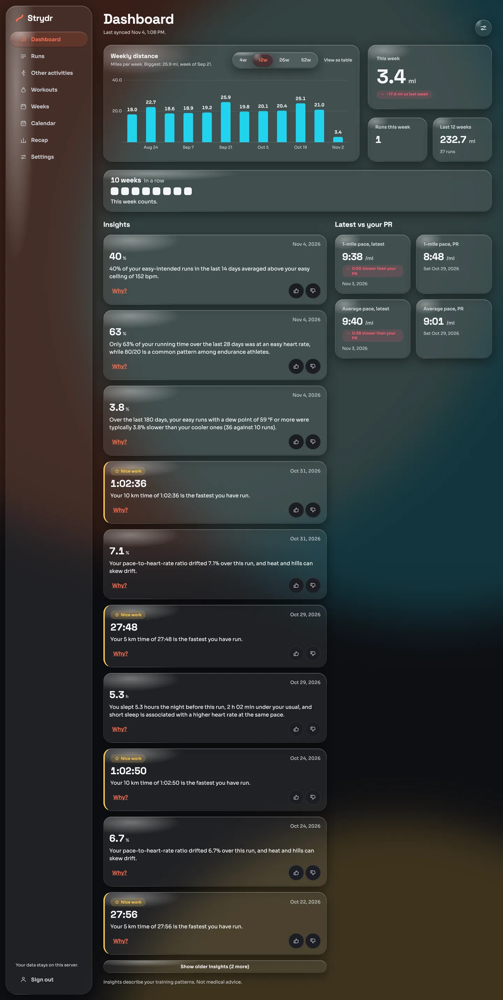

The first page after you sign in.

- **Weekly distance**: a bar per week over 4, 12, 26 or 52 weeks, with the biggest week named. **View as table** shows
  the same numbers as a table (every chart in Strydr has this).
- **This week**: distance so far, with the change against last week, runs this week and the last 12 weeks.
- **Streak**: consecutive weeks that count, shown as squares. See [Home workouts](home-workouts.md#weekly-streak).
- **Insights**: the latest facts about your training, newest first. Each has a number, one or two plain sentences, a
  **Why?** link that opens the evidence behind it, and thumbs up or down so you can tell Strydr which ones are useful.
  Records and milestones are marked **Nice work**. See the [Insights reference](insights.md).
- **Latest vs your PR**: your latest 1-mile pace and average pace against your best.
- **Last synced**: when the last data arrived. It turns into a warning when nothing has arrived for a week.

## Runs

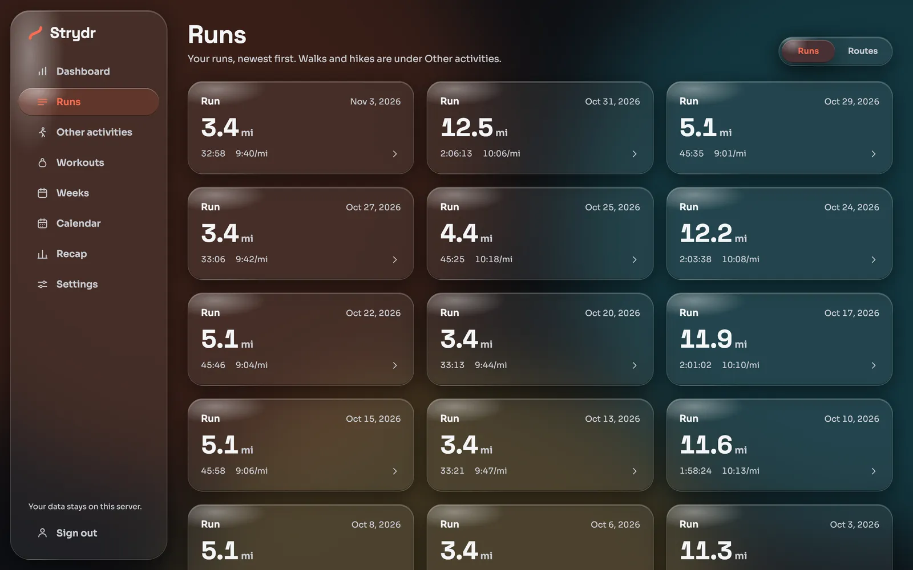

All your runs, newest first, as cards with distance, time and pace. The **Runs / Routes** switch at the top goes to
[Routes](#routes).

## Run detail

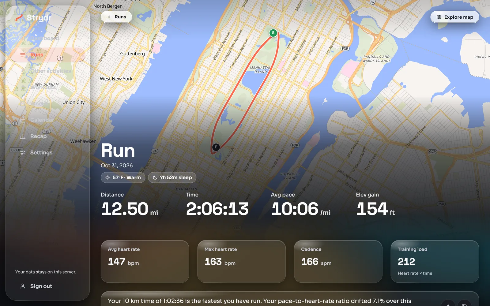

Open any run to see everything about it.

**The map** fills the top of the page with your route, start (S) and end (E) marks. Parts inside a
[privacy zone](privacy-and-security.md#privacy-zones) are cut out before the route ever reaches the browser.
**Explore map** opens it full size.

**Headline numbers**: distance, moving time, average pace and elevation gain; then average and max heart rate, cadence
and [training load](metrics.md#training-load). Chips under the title show the weather and the sleep you had the night
before.

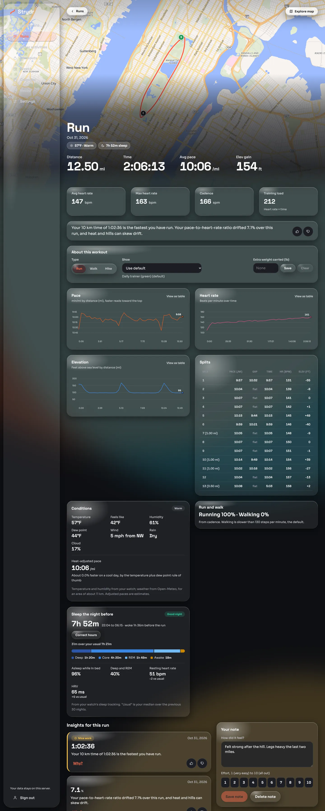

Further down:

| Section | What it shows |
|---|---|
| **About this workout** | The type (Run, Walk, Hike), the shoe (your default or another pair) and any extra weight carried |
| **Pace, Heart rate, Elevation** | Charts over distance or time, each with **View as table** |
| **Splits** | Per mile or kilometre: pace, [grade-adjusted pace](metrics.md#grade-adjusted-pace) (GAP), time, average heart rate and elevation change |
| **Conditions** | Temperature, humidity, dew point, and with [weather lookup](privacy-and-security.md#weather-lookup) also feels-like, wind, rain and cloud. A [heat-adjusted pace](metrics.md#heat-adjusted-pace) estimates your pace on a cool day |
| **Run and walk** | How much of the run you ran and walked, from cadence |
| **Sleep the night before** | Hours slept, bedtime and wake time, stages, time asleep in bed, resting heart rate and HRV against your usual. **Correct hours** fixes a wrong night |
| **Insights for this run** | Facts that apply to this run, such as a new best effort or cardiac drift |
| **Your note** | Free text and an effort from 1 (very easy) to 10 (all out) |

## Other activities

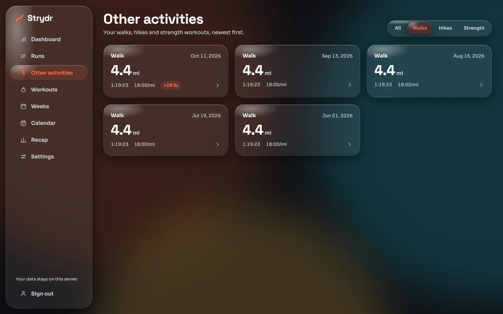

Walks, hikes and watch strength workouts, with filters for each. Strength workouts show their time and average heart
rate; a walk with carried weight shows it as a badge (**+29 lb**). Walks and hikes count toward your training load, but run insights and run comparisons
leave them out.

## Routes

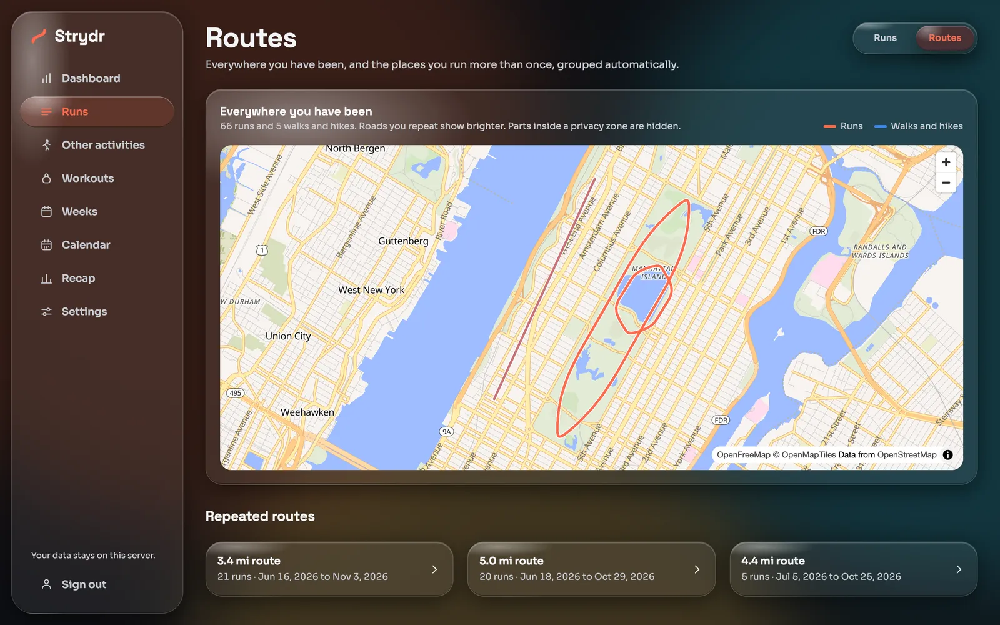

**Everywhere you have been** draws every run (red) and walk or hike (blue) on one map. Roads you repeat show brighter.

**Repeated routes** are found automatically: runs that start and end in the same places, have a similar distance, and
follow the same path in the same direction. A reverse run is a separate route, linked to its twin. Open one to compare:

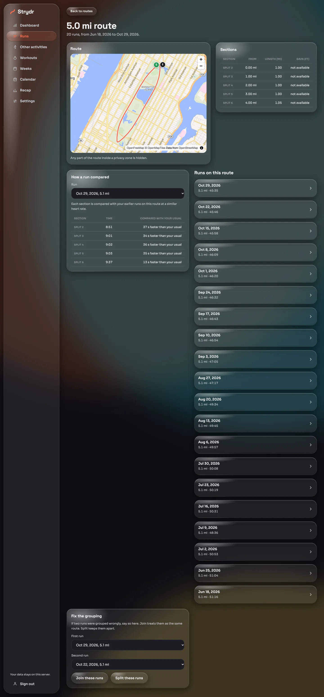

- **Route** map and **Sections**: the route cut into pieces, with length and climb.
- **How a run compared**: pick a run; each section is compared with your earlier runs on the route at a similar heart
  rate ("37 s faster than your usual").
- **Runs on this route**, newest first.
- **Fix the grouping**: if two runs were grouped wrongly (or should be together), join or split them. Your choice is
  kept from then on.

## Weeks

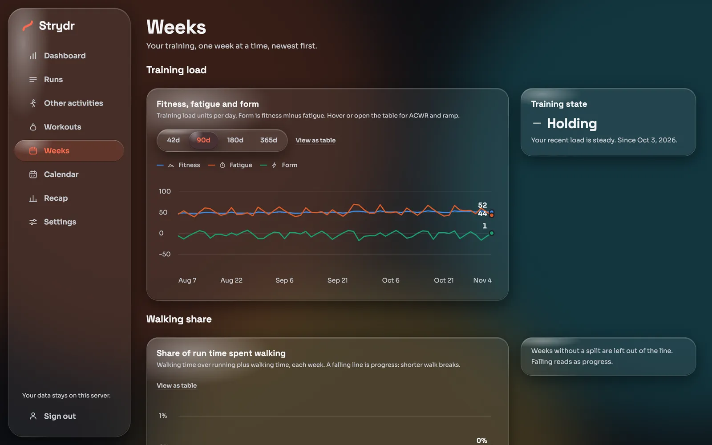

One card per week, newest first, plus **Training load**:

- **Fitness, fatigue and form** over 42, 90, 180 or 365 days. Fitness is your long-term load, fatigue the last week or
  so, and form the difference. Details: [Training load](metrics.md#fitness-fatigue-and-form).
- **Training state**: Building, Holding, Easing or Overreaching, and since when.
- **Walking share** and other trends.

Open a week for its detail:

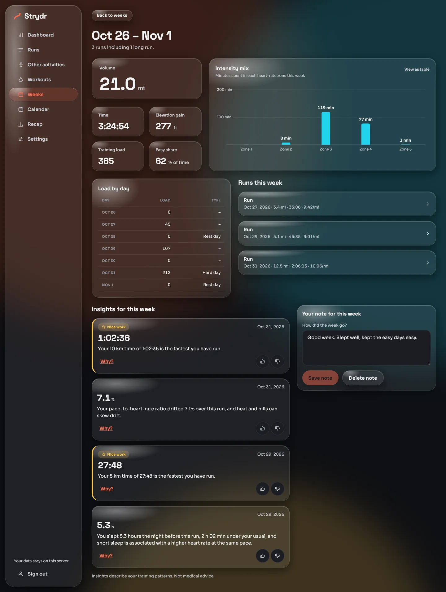

Volume, time, elevation, training load and easy share; the **intensity mix** (minutes in each heart-rate zone); **load
by day** with hard days and rest days marked; the runs; insights for the week; and a note for the week.

## Calendar

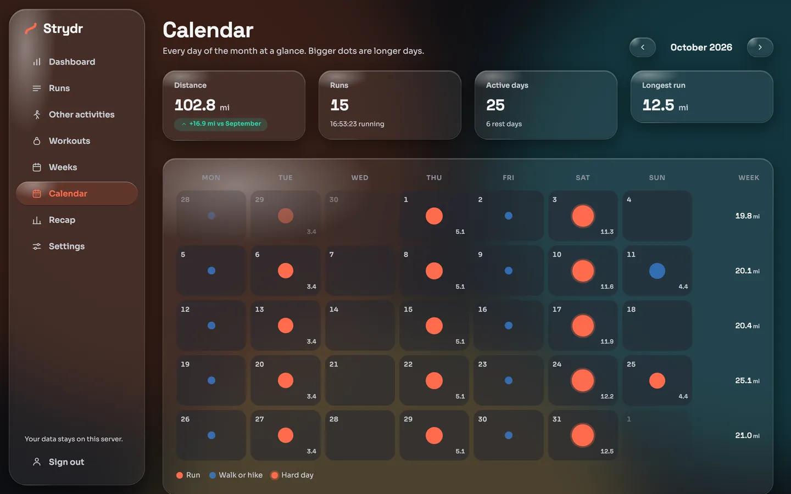

A month at a glance. Each day has a dot: red for a run, blue for a walk or hike, a ring for a hard day, bigger for a
longer day, with the distance in the corner. The right column totals each week. Cards on top give the month's
distance (against the previous month so far), runs, active and rest days, and the longest run.

## Recap

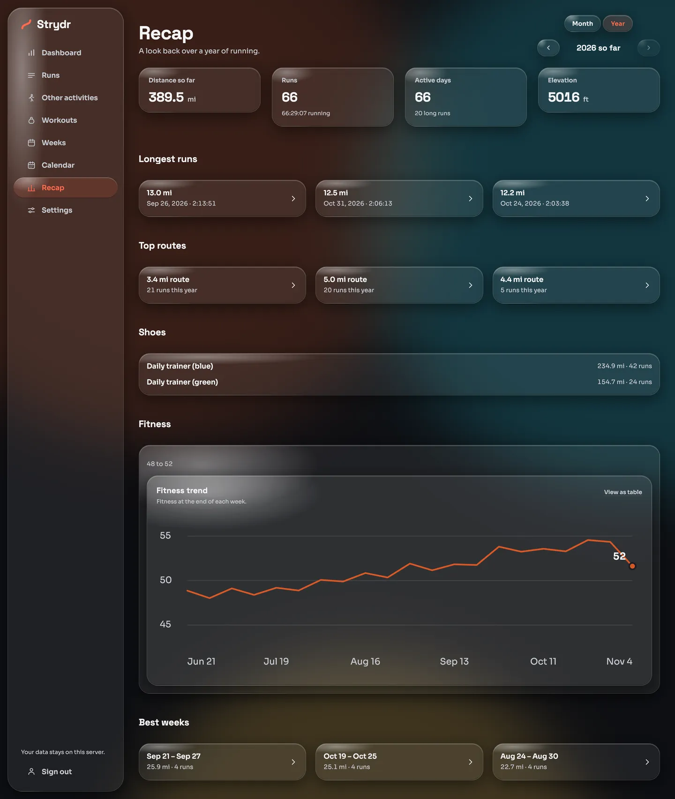

A look back over a month or a year (**Month / Year**, then the arrows): distance, runs, active days, elevation, your
longest runs, top routes, distance per shoe, the fitness trend and your best weeks. The current period reads "so far".

## Workouts

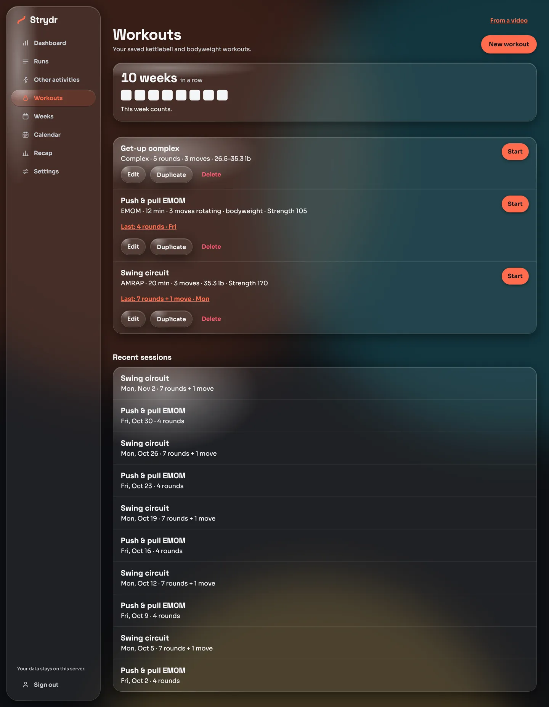

Your saved kettlebell and bodyweight workouts, with a live full-screen timer for doing them, a summary afterwards with
your watch's heart rate, and progress over time. This has its own page: [Home workouts](home-workouts.md).

## Settings

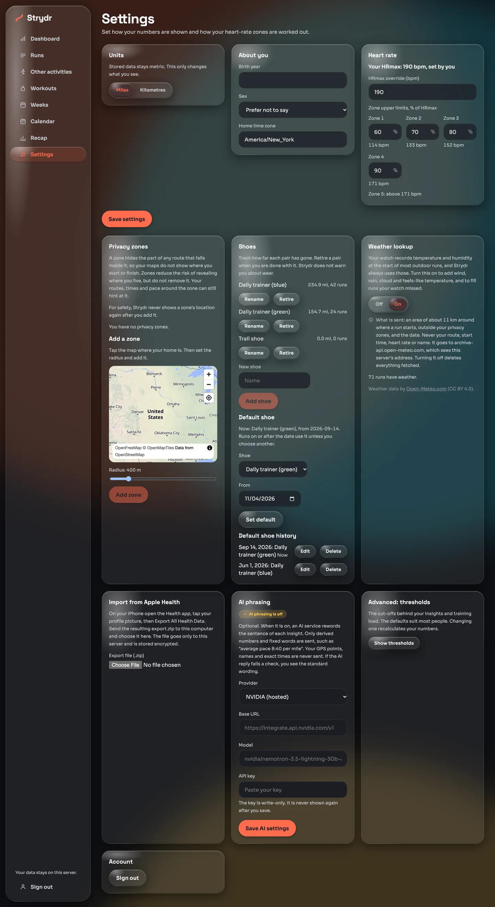

| Card | What it does |
|---|---|
| **Units** | Miles or kilometres. Stored data stays metric |
| **About you** | Birth year, sex and home time zone |
| **Heart rate** | Your HRmax (set your own, or the age estimate is used) and the upper limit of zones 1 to 4 as % of HRmax, with the bpm shown |
| **Privacy zones** | Tap the map where you live, set a radius, add. The location is never shown again. See [Privacy zones](privacy-and-security.md#privacy-zones) |
| **Shoes** | Add, rename and retire pairs; see each pair's distance and runs; set a default shoe from a date, with the history of defaults |
| **Weather lookup** | Off by default. Fills wind, rain, cloud and feels-like, and runs your watch missed. See [Weather lookup](privacy-and-security.md#weather-lookup) |
| **Import from Apple Health** | Upload `export.zip`. See [Apple Health export](importing-data.md#apple-health-export) |
| **AI phrasing** | Off by default. Lets an AI model reword insights. See [AI phrasing](privacy-and-security.md#ai-phrasing) |
| **Advanced: thresholds** | Change the cut-offs behind insights and load, for example what counts as a hard day. See [Configuration](configuration.md#thresholds) |
| **Account** | Sign out |

Changing your profile, zones, thresholds or privacy zones recomputes your whole history in the background.

## Light and dark

Strydr follows your system's light or dark setting.

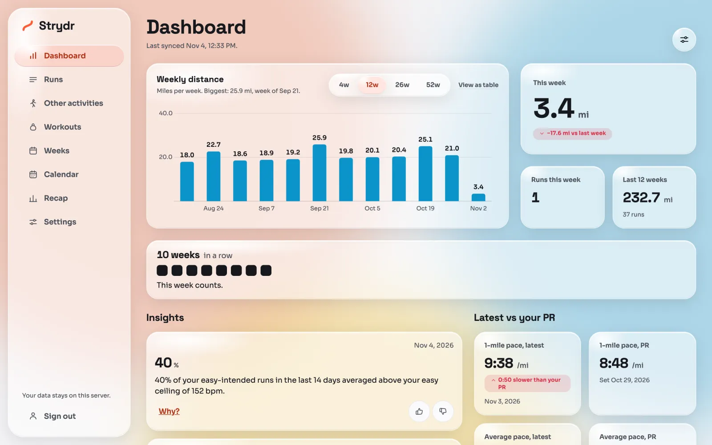

## On your phone

Open the same address on your phone's browser, on your home Wi-Fi or over Tailscale.

  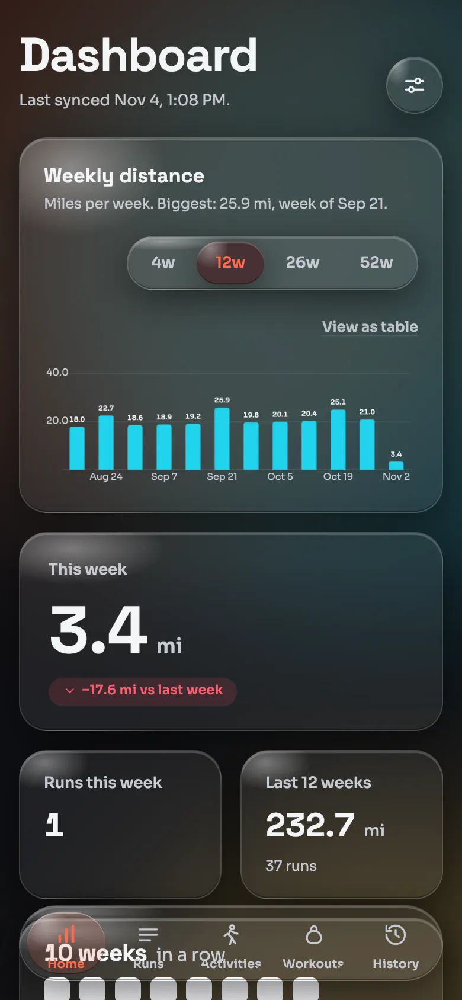
  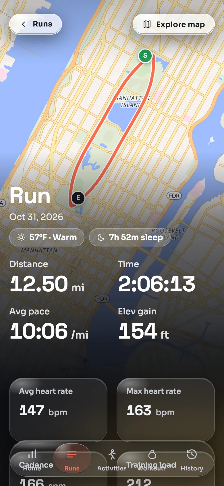
  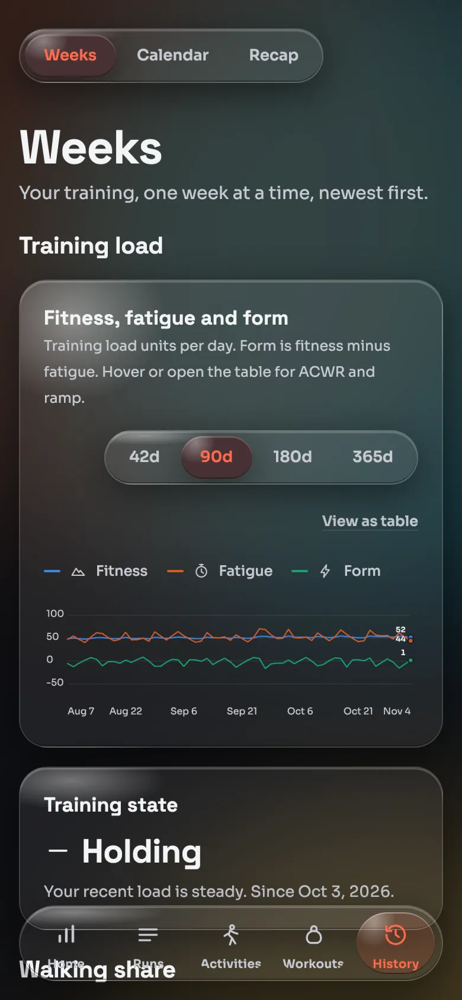

