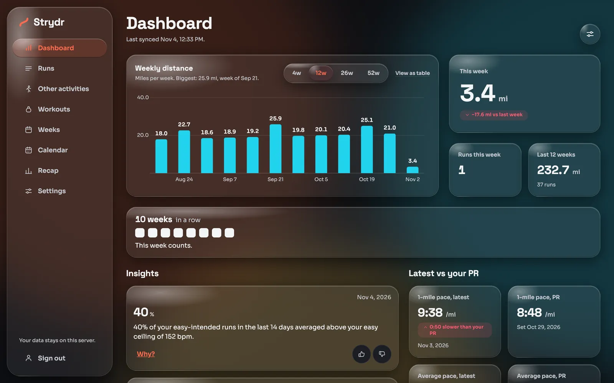

# Getting started

This page takes you from nothing to your first run on the Strydr dashboard.

## What you need

- **An Apple Watch and an iPhone.** Strydr reads what your watch writes to Apple Health: workouts with GPS routes and
  heart rate, plus daily metrics such as resting heart rate, HRV, sleep, steps and weight.
- **A computer that stays on at home.** A Linux server or NAS, a Windows PC, or a Mac. It needs about 10 GB free for
  Docker and the images. Strydr keeps every raw payload and full-resolution GPS and heart rate, so plan on a few
  hundred megabytes per year of daily running.
- **One way to get data out of Apple Health:**
  - **Health Auto Export** (iOS app; REST API automations may need its paid upgrade) for automatic syncs, or
  - Apple's own **Export All Health Data** (free) for a one-off or occasional upload.

Strydr has one user: you. There is no sign-up, and nothing is sent to a Strydr service, because there isn't one.

## 1. Install the server

| Platform | Guide | Time |
|---|---|---|
| Windows 10 22H2 or Windows 11 | [One-step installer](../install/windows/README.md) | 15 to 40 minutes, one restart |
| Linux with Docker | [Docker install](installation.md#docker-linux) | About 10 minutes |
| macOS or Linux without Docker | [Development setup](development.md) | About 10 minutes |

Every install ends the same way: you set a password and Strydr prints an **ingest token** once. Save the token: it is
the password your iPhone uses to send data.

> **Keep the database key safe.** Strydr encrypts everything with a key file that is created during install. Lose the
> key and the data cannot be read, including the backups. Store a copy somewhere separate from the server.

## 2. Sign in

Open `http://<server>:8080` in a browser on the same network (or over [Tailscale](installation.md#tailscale)) and sign in
with the username and password from step 1. The default username is `runner` unless you chose another with
`strydr init --username`.

## 3. Send your data

Choose one:

- **Automatic:** add two REST API automations in Health Auto Export (one for Workouts, one for Health Metrics) that
  post JSON to `http://<server>:8081/ingest/hae` with the header `Authorization: Bearer <ingest token>`. Do one large
  backfill of your history first, then let them run on a schedule. Full steps: [Health Auto Export](importing-data.md#health-auto-export).
- **Manual and free:** in the Health app, tap your profile picture, then **Export All Health Data**. Move the
  `export.zip` to your computer and upload it in **Settings → Import from Apple Health**. Full steps:
  [Apple Health export](importing-data.md#apple-health-export).

Strydr processes new data in the background. The dashboard shows **Last synced** at the top, and a fresh import usually
finishes in a few seconds to a minute.

## 4. Set up your profile

Open **Settings** and fill in:

- **Units:** miles or kilometres. Stored data is always metric; this only changes what you see.
- **About you:** birth year and sex, used for the age-based maximum heart rate and the training-load formula.
- **Heart rate:** set your own HRmax if you know it, and adjust the zone limits if you like.
- **Home time zone:** decides which day a run belongs to.
- **Privacy zones:** tap the map where you live so routes near home are hidden. See
  [Privacy zones](privacy-and-security.md#privacy-zones).
- **Shoes** (optional): add your pairs and pick a default.

Changing any of these recomputes your history, so every number stays consistent.

## 5. Explore

- The [Dashboard](features.md#dashboard) shows this week, your streak and the latest insights.
- Open any run for the [full breakdown](features.md#run-detail).
- After a few weeks, [Weeks](features.md#weeks) shows fitness, fatigue and form, and repeated routes appear under
  [Routes](features.md#routes).
- Some insights need history before they can say anything: resting-heart-rate checks need 21 days and HRV checks need 40.
  See the [Insights reference](insights.md).

Next: [Importing data](importing-data.md) in depth, or the [Feature tour](features.md).
