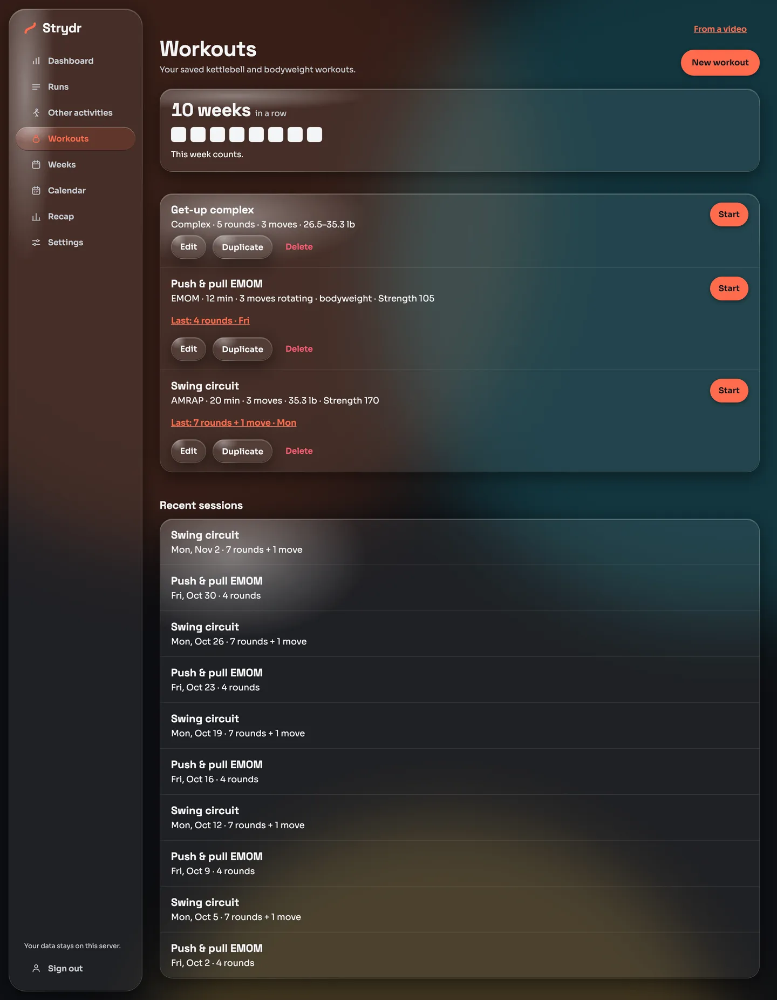
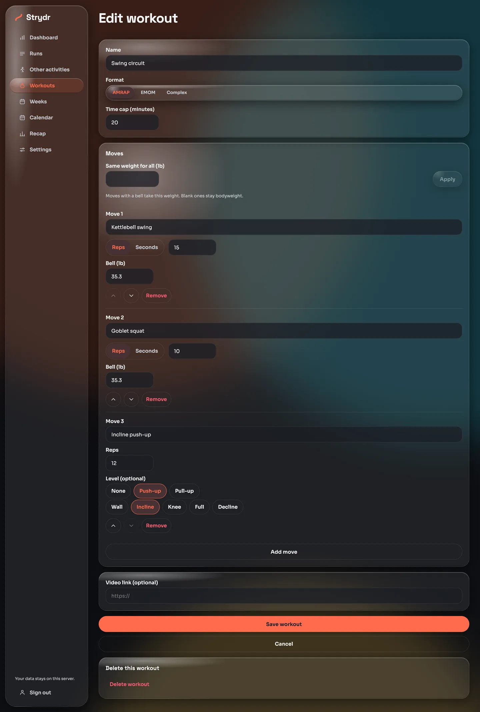
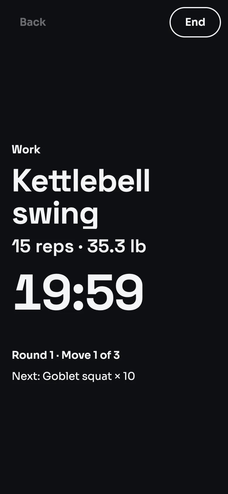
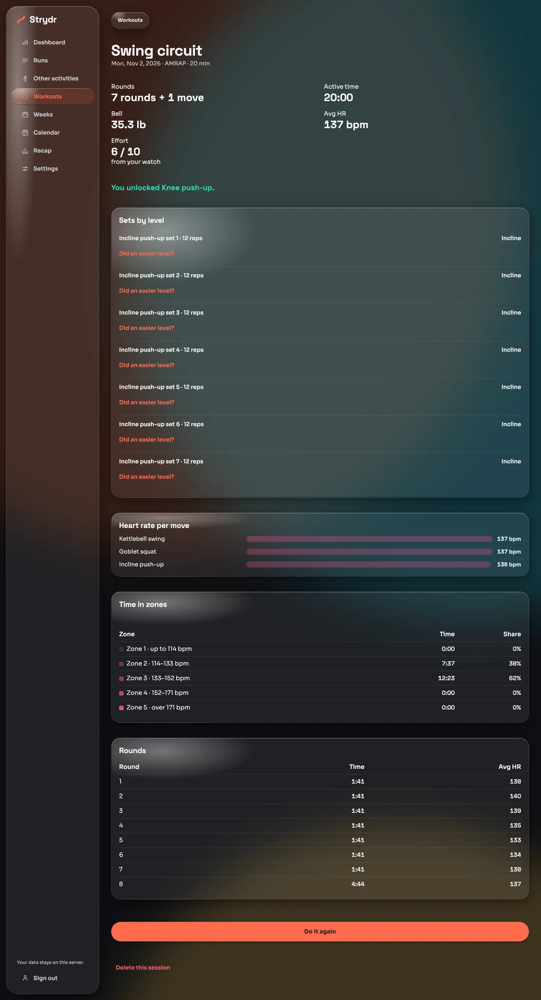
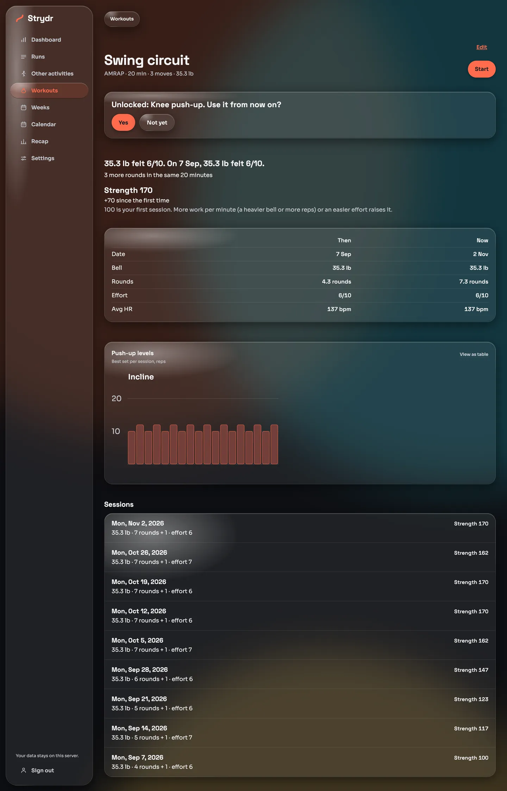

# Home workouts

Strydr also tracks kettlebell and bodyweight workouts done at home. The idea is "no forms, it just remembers for you":
you save a workout once, tap through it on your phone while it runs, and Strydr matches it with your watch's heart rate
and keeps track of your progress.

- [Workout library](#workout-library)
- [Building a workout](#building-a-workout)
- [From a YouTube Short](#from-a-youtube-short)
- [The live screen](#the-live-screen)
- [Session summary](#session-summary)
- [Progress and strength score](#progress-and-strength-score)
- [Bodyweight levels](#bodyweight-levels)
- [Weekly streak](#weekly-streak)
- [With your watch](#with-your-watch)
- [Workouts done with only the watch](#workouts-done-with-only-the-watch)

## Workout library

**Workouts** lists your saved plans, with the format, length, moves and bell weight, your latest **strength score**, and
a link to the last session. Each plan can be started, edited, duplicated or deleted. **Recent sessions** below lists
what you have done, newest first.

## Building a workout

**New workout** opens the editor. A workout has a name, a format and up to 12 moves.

| Format | How it runs | Setting |
|---|---|---|
| **AMRAP** | As many rounds as possible: go through the moves in order, again and again, until the time cap | Time cap (minutes) |
| **EMOM** | Every minute on the minute: one move per minute, rotating through the list | Length (minutes) |
| **Complex** | A fixed number of rounds of the moves, at your own pace | Rounds |

Each move has a name and **either** reps **or** seconds (for holds and carries such as a plank or a suitcase carry),
and optionally a bell weight. **Same weight for all** sets every weighted move at once; moves left blank are bodyweight.
A move can follow a [bodyweight level](#bodyweight-levels) instead of a name. Add an optional video link to keep the
source with the plan. Moves can be reordered with the arrows.

## From a YouTube Short

**From a video** on the Workouts page builds a draft plan from a YouTube Short or video link. Strydr fetches the
video's public title, description and captions with [yt-dlp](https://github.com/yt-dlp/yt-dlp), asks your AI provider
to turn them into moves, reps and a format, and opens the result in the editor for you to check. Nothing is saved until
you press **Save workout**.

- It needs [AI phrasing](privacy-and-security.md#ai-phrasing) to be on, since the AI provider reads the video text.
- Only the video ID goes to YouTube, with cookies and config off; none of your data is involved.
- Private, removed and age-restricted videos, or videos without captions, cannot be read.

## The live screen

  

**Start** opens a full-screen timer made for a phone propped on the floor:

- **Get ready** counts you in. **Cancel** leaves without saving anything.
- The move, its reps or seconds, the bell weight, the clock, and what comes next, in large type.
- **Tap anywhere** to finish a move (AMRAP and complex). Timed moves and EMOM minutes advance by themselves.
- In an **EMOM**, tap if you **fell short** in a minute; tap again to undo. After the workout you can say how many reps
  you got.
- **Back** (top left) undoes an accidental tap. It is disabled right after an automatic advance.
- **Pause** and resume (space bar on a keyboard). **End** finishes early.
- Short tones mark each minute and the end of timed moves. They play over your music instead of stopping it.
- The screen stays awake while the workout runs (where the browser supports it).
- Progress is kept on the phone while you go, so a reload or a locked screen does not lose the session.

## Session summary

When you finish, Strydr saves the session and shows:

- **Rounds** done (for example "7 rounds + 1 move"), active time, bell weight.
- **Effort** from your watch's effort score, or a 1 to 10 picker when the watch gave none.
- **Heart rate** from the matching watch workout: average, **per move**, **per round**, and **time in zones**.
- **Sets by level** for bodyweight-level moves, each with **Did an easier level?** to record that you stepped down.
- Any level you just **unlocked**.
- **Do it again** starts the same plan; **Delete this session** removes it.

## Progress and strength score

Open a plan to see its progress:

- A headline that compares like with like: "35.3 lb felt 6/10. On 7 Sep, 35.3 lb felt 6/10. 3 more rounds in the same
  20 minutes."
- **Strength score.** Your first session of a plan is 100. Later sessions score higher when you do more work per active
  minute (reps or seconds times the bell weight), or the same work at an easier effort. Each move has its own baseline,
  so adding a move or moving up a level starts that move afresh. The score needs at least two sessions.
- **Then and now**: date, bell, rounds, effort and average heart rate for your first and latest session.
- A chart of each **bodyweight level**: your best set per session.
- Every session, with its score.

## Bodyweight levels

Push-ups and pull-ups can follow a ladder from easiest to hardest:

| Ladder | Levels |
|---|---|
| Push-up | Wall → Incline → Knee → Full → Decline |
| Pull-up | Negative → Band-assisted → Full |

Pick a level for a move in the editor. When you do **3 sets of 12 reps or more** at a level, the next one unlocks, and the
workout page asks **Use it from now on?**. Say **Yes** to move up, or **Not yet** to stay. If you did an easier level for
some sets, record it on the session summary so the counts stay honest.

## Weekly streak

The streak on the dashboard and the Workouts page counts **consecutive weeks** (Monday to Sunday) with at least one home
workout: a Strydr session or a strength workout from your watch. The current week never breaks the chain while it is
still open, and the squares show the last eight weeks.

## With your watch

Start a **Functional** or **Traditional Strength Training** workout on your Apple Watch when you start the session in
Strydr. After the watch workout syncs (through [Health Auto Export](importing-data.md#health-auto-export) or an
[Apple Health export](importing-data.md#apple-health-export)), Strydr matches it to the session that overlaps it most
and fills in heart rate and effort on the summary. Without a watch workout, the session still counts for the streak,
rounds and score; the heart-rate sections are simply empty.

## Workouts done with only the watch

If you train with only your watch running and no Strydr session, Strydr notices the watch strength workout once it
syncs and asks about it on the Dashboard and the Workouts page, with a guess from your history:

> Same as last Tuesday: Swing circuit, 35 lb, 7 rounds?

- **Yes, log it** saves it as a session on the watch's times, with the watch's heart rate and effort. Its summary says
  "Logged from your watch" and has no per-move or per-round times, since there were no taps.
- **Something else** lets you pick another workout and change the bell and rounds.
- **Not a Strydr workout** stops asking about it.

The guess is your latest session on the same weekday, or your latest session on any day. Strydr asks about each watch
workout once, and only about those from the last 14 days.
