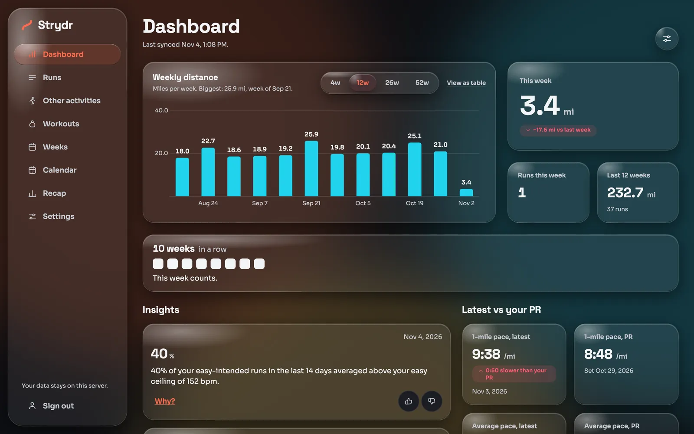

# Insights reference

Insights are short facts about your training, worked out by rules from your own data. Each one has:

- a **number** (a time, a percentage, hours of sleep),
- one or two plain sentences (the template, or an [AI rewording](privacy-and-security.md#ai-phrasing) checked against
  the facts),
- a **Why?** link with the evidence: the values, the window and the comparison the rule used,
- thumbs up and down, so you can mark which ones are useful.

There are three kinds: **observations**, **attaboys** (marked **Nice work**) and **check readings** (a value so far out
of range it is probably a sensor error, so Strydr does not interpret it).

Insights describe patterns. They never diagnose, prescribe or predict, and they use cautious wording ("is associated
with", "can skew"). Apple Watch heart rate and HRV are noisy, and the wording says so.

## Rules

Every number below is a default from `backend/config/thresholds.toml` and can be changed in
**Settings → Advanced: thresholds** (see [Configuration](configuration.md#thresholds)).

### Records and consistency

| Rule | Fires when |
|---|---|
| `attaboys-streaks` | A best effort over a standard distance (1 km, 1 mile, 5 km, 10 km, half marathon, marathon), your longest run (after at least 10 earlier runs), a lifetime distance milestone (100, 250, 500, 1000, 2500), a record week or month (after 8 weeks or 3 months of history), or a streak of weeks with at least 3 runs reaching 4, 8, 12, 26 or 52. One missed week in 12 is forgiven: the streak is "paused, not broken". There are no daily streaks |
| `long-run-spike` | A run is more than 10% longer than your longest run of the last 30 days |
| `weekly-ramp` | This week's running is more than 30% above the average of the previous 4 weeks. A record week is held back when a ramp fired that week |

### Intensity and effort

| Rule | Fires when |
|---|---|
| `intensity-mix` | Under 70% of your running time over 28 days was at an easy heart rate (needs 8 runs with heart rate). 80/20 is a common pattern among endurance athletes |
| `easy-creep` | In the last 14 days at least 40% of your easy-intended runs averaged above your easy ceiling, or your easy pace got 5% faster while heart rate rose 3 bpm or more against the previous 8 weeks |
| `pace-at-fixed-hr` | Your median flat-ground pace inside a 10 bpm band around your usual easy heart rate changed by 3% or more between the last 4 weeks and the 4 before. Faster is an attaboy. Hot runs (24 °C or more) are left out |
| `cardiac-drift` | On a steady, easy run of 40 minutes or more (the first 10 ignored), your pace-to-heart-rate ratio drifted more than 5% (notable) or 10% (high). Under 5% on a run of 60 minutes or more is an attaboy. Hot runs are tagged and left out of trends |

### Load and recovery

| Rule | Fires when |
|---|---|
| `training-state` | Your [training state](metrics.md#training-state) changes to Building, Holding, Easing or Overreaching and stays for 3 days |
| `hard-day-stacking` | Two hard days in a row, or 3 hard days in any 7; or monotony (mean / SD of daily load over 7 days) above 2.0 while the week's load is at or above your 4-week average |
| `no-rest-day` | 6 or more days in a row without a rest day, carrying at least half your usual weekly load. You can switch it off, for example while run-streaking |
| `resting-hr` | Resting heart rate at or above your 30-day mean plus the larger of 5 bpm and 1.5 SD, for 3 days in a row (needs 21 days of history). A reading outside 35 to 100 bpm, or 15 bpm above your mean in one day, gets a neutral **check reading** instead |
| `hrv` | The 7-day mean of your HRV (log SDNN) falls more than 1 SD below your 60-day baseline for 2 days in a row (needs 40 days). Mentions it when resting heart rate is also up |

### Conditions and sleep

| Rule | Fires when |
|---|---|
| `heat-adjusted-pace` | Heat and humidity account for 3% or more of a recent outdoor run's pace, by the temperature plus dew point rule of thumb |
| `hill-adjusted-pace` | A run's [grade-adjusted pace](metrics.md#grade-adjusted-pace) is 2% or more faster than its actual pace |
| `pace-by-conditions` | Over 180 days, your easy outdoor runs with a dew point of 15 °C (59 °F) or more were typically 3% or more slower than cooler ones (needs 6 runs on each side) |
| `short-sleep-run` | You slept at least 1 hour under your usual the night before a run (or under 6 hours while there is no usual yet) |
| `effort-by-sleep` | Over 120 days, after short nights your easy runs cost 3% or more heartbeats per metre than after good nights (needs 5 runs on each side) |

### Routes and context

| Rule | Fires when |
|---|---|
| `same-route-hr` | On a [repeated route](features.md#routes), a section of this run was clearly faster or slower than your usual there at a similar heart rate |
| `carry` | A run with carried weight (a pack, vest or child). Says so, so a slower pace reads as context. Carried runs are compared only with other carried runs |

## Which activities count

Run insights use runs only. Walks and hikes add to your training load and rest-day logic, but are not judged as runs.
A carried run is judged only against other carried runs, in trends, same-route comparisons and the AI summary.

## The AI run summary

With [AI phrasing](privacy-and-security.md#ai-phrasing) on, each run also gets a two or three sentence summary of how it
went, built from the run's own numbers and a few similar past runs. Strydr checks every reply: no exclamation marks, no
banned wording, a length limit, and every number must come from the facts it was given. A reply that fails any check is
thrown away and the template wording is shown instead.
