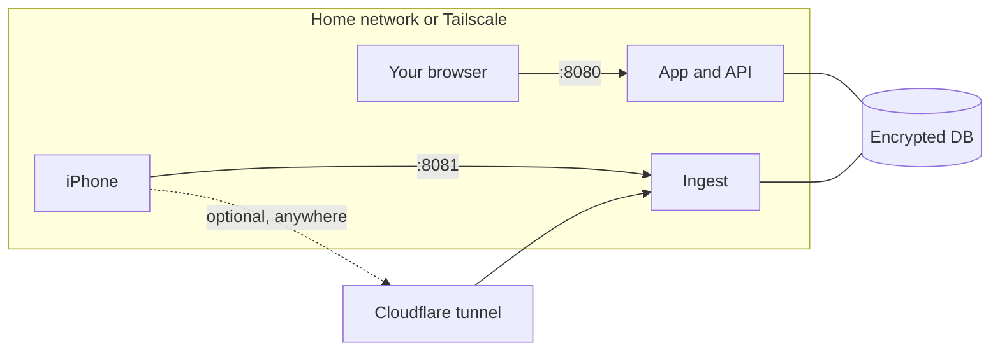

# Privacy and security

Strydr is built for the most personal data you have: where you live, when you leave the house, your heart and your
sleep. These are the choices that protect it, and the places where data does leave the server.

- [At rest](#at-rest)
- [Network layout](#network-layout)
- [Sign-in and tokens](#sign-in-and-tokens)
- [Privacy zones](#privacy-zones)
- [What leaves the server](#what-leaves-the-server)
- [Weather lookup](#weather-lookup)
- [AI phrasing](#ai-phrasing)
- [What your browser loads](#what-your-browser-loads)
- [Reporting a vulnerability](#reporting-a-vulnerability)

## At rest

- **One encrypted database.** Everything, including raw payloads, routes, notes and settings, is in a single
  [SQLCipher](https://www.zetetic.net/sqlcipher/) database. The key is a separate file (a Docker secret in production),
  never an environment variable and never in the database.
- **Encrypted backups.** Nightly snapshots use the same key, so a copied backup is useless without it.
- **No telemetry.** Strydr has no analytics, crash reporting or update checks.
- **Logs say little.** Error messages carry exception class names, not values, names, dates or locations.

Losing the key loses the data. Keep a copy of it somewhere other than the server and its backups.

## Network layout

- **`8080` (app)** serves the web app and API. Keep it on your home network or Tailscale. Never route a tunnel or a
  port forward to it.
- **`8081` (ingest)** accepts only `POST /ingest/hae` with the bearer token. It is the only port meant for the optional
  Cloudflare tunnel.
- Keep both closed on your router. Do not use `tailscale funnel`.
- `GET /api/v1/health` is public and touches neither the database nor the key, so health checks reveal nothing.

## Sign-in and tokens

- One user. The password (8 characters or more) is hashed with **Argon2**; unknown usernames take the same time to fail.
- Signing in sets an **HttpOnly, SameSite=Strict** session cookie that lasts 30 days. Only a SHA-256 digest of the
  session and of the ingest token is stored, and tokens are compared in constant time.
- The ingest token is shown once by `strydr init`. `strydr init --reset` replaces the user and the token.

Strydr serves plain HTTP and expects a trusted network (your LAN or Tailscale's encrypted tunnel). If you put it
behind your own HTTPS reverse proxy, keep it off the public internet anyway.

## Privacy zones

A privacy zone hides the part of every route that falls inside a circle, so maps do not show where you start or finish.

- Add one in **Settings → Privacy zones**: tap the map, choose a radius (50 m to 5 km, 400 m by default) and add it.
- The centre is **write-only**. No endpoint ever returns it, so a leaked session or a cached page cannot reveal it.
- The clip circle is moved by a random offset of up to 100 m, drawn once, so the edge of the gap does not point at the
  true centre.
- Routes are clipped when Strydr recomputes, and only the clipped geometry is ever sent to the browser.
- Weather lookups never use a point inside a zone.

Zones reduce the risk of revealing home but do not remove it: routes, times and pace around a zone can still hint at it.

## What leaves the server

Nothing leaves unless you turn it on. Every outbound call goes through one egress gateway with an allow-listed shape.

| Feature | Off by default | Goes to | What is sent |
|---|---|---|---|
| [Weather lookup](#weather-lookup) | Yes | `archive-api.open-meteo.com` | A 0.1° grid cell (about 11 km) and a date |
| [AI phrasing](#ai-phrasing) | Yes | Your chosen AI provider | Derived numbers and fixed words, no locations or times |
| [YouTube import](home-workouts.md#from-a-youtube-short) | Needs AI on | YouTube (via yt-dlp), then your AI provider | The video ID; then the video's public text |

## Weather lookup

Your watch already records temperature and humidity at the start of most outdoor runs, and Strydr always uses those.
Turning on **Weather lookup** adds wind, rain, cloud and feels-like temperature, and fills runs the watch missed.

Each request carries only a 0.1° grid cell (about 11 km across) around where a run starts, outside your privacy zones,
and the date. Never your route, start time, heart rate or name. The provider,
[Open-Meteo](https://open-meteo.com/) (ERA5 reanalysis, CC BY 4.0), sees your server's IP address. Turning it off
deletes everything fetched.

## AI phrasing

Off by default. When on, an AI model rewords insights and writes a short summary for each run. Strydr works fully
without it.

- **What is sent:** an allow-listed payload of derived numbers and fixed vocabulary, such as "average pace 8:40 per
  mile". No GPS points, names, exact times, notes or free text. Any field not on the list is rejected before sending.
- **What comes back is checked:** at most two sentences, no exclamation marks, no banned wording, and every number must
  belong to the fact. A reply that fails is thrown away and the standard wording is shown.
- **Providers:** NVIDIA's hosted API (`https://integrate.api.nvidia.com/v1`, default model
  `nvidia/nemotron-3.5-lightning-30b-a3b`), or any **OpenAI-compatible** endpoint with your own base URL and model,
  including a local server such as Ollama or LM Studio on `http://localhost`.
- **The key is write-only.** No endpoint returns it. Clearing it turns AI off.
- Calls run in the background with a 20-second timeout, only when no other processing is pending. Pages never wait on
  the AI.

## What your browser loads

The web app itself is served by your server, but the browser fetches two things from the internet:

- **Map tiles** from [OpenFreeMap](https://openfreemap.org/) (OpenStreetMap data). The tile server sees your IP and
  which map area you view, though not your route, which is drawn locally.
- **Fonts** (Sora, Space Grotesk, JetBrains Mono) from Google Fonts.

## Reporting a vulnerability

Please report security problems privately through
[GitHub security advisories](https://github.com/OuttaLineNomad/strydr/security/advisories/new) rather than a public
issue.
